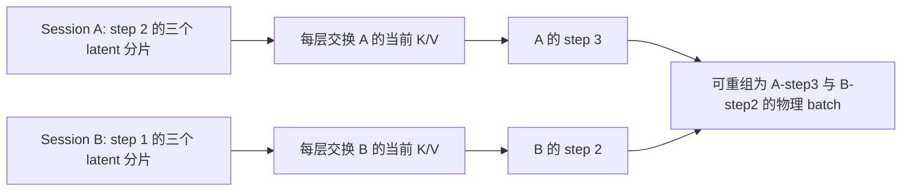

# ABot-World：VAE 批处理与 Step–Latent Continuous Batching

更新日期：2026-10-23。本说明对应直接 pipeline 的可选实现，不代表已有五类/真实 trace 的实验结果已经切换。

本页描述较早的 chunk-step batching 和三卡 frame-sharding 路径。
按用户要求新增的完整 `(session, latent, step)` 调度、任意卡数任务池与 CUDA Graph 后端，见
[完整 Latent–Step 任务执行器](abot_world_latent_step_runtime.md)。该路径不继续切分 latent 的空间网格。

## 核心结论

可以把原来一次占用完整 chunk 的执行拆成可恢复的 DiT step，并在 step 边界动态加入、移除 session。
同一物理 batch 可以包含不同 session 的不同 diffusion timestep，模型原本就支持逐 batch row 的 timestep embedding。
三卡模式继续把每个 session 当前 chunk 的三个 latent 分摊到三张卡。

这与 LLM 的 iteration-level batching 有相似的执行边界：保留请求状态，每轮 forward 后重新组 batch，
而不必等待整条请求完成。[SGLang 官方 mini 实现](https://github.com/sgl-project/mini-sglang/blob/main/python/minisgl/scheduler/scheduler.py)
展示了逐轮选择 batch、运行 forward 和更新请求状态的结构。

但 ABot 的一个 latent 不能直接等同于独立的 LLM token。当前 attention 在每层都使用同一个 chunk 全部 latent 的当前 K/V，
所以三张卡上的 latent 分片必须交换 K/V。不同 session 可以处于不同 step；同一 session 的当前 latent 组须共同推进。

## 依赖边界

一个默认 chunk 包含三个 latent，采样器有四次 denoising forward，最后还有一次 timestep=0 的 KV refresh。
因此最多有 15 个“step × latent 分片”的计算位置，但它们不是 15 个独立的调度任务。



调度可以发生在两个完整 DiT forward 之间。单个 forward 内，原有 transformer 层顺序和通信依赖保持不变。
不能在缺少其它 latent 当前 K/V 的情况下让一片任意跨 step 前进，也不能直接删除这些通信来宣称零成本并行。

## VAE 批处理修正

交互回放实际使用 TAeW2.2 轻量流式解码器。它已有 batch 入口，但原有兼容判断要求累计解码帧数完全一致。
对已经完成启动裁剪的 session，这个条件过强：累计解码帧数只决定是否还处于首段裁剪阶段，不决定后续卷积计算。

当前实现按启动阶段、待处理队列布局、时序 memory 的形状、dtype 和 device 分组：

- 已初始化、状态布局兼容的 session，即使分别已解码 12 帧和 120 帧，也可以组一个 batch。
- 合并执行后按各自的旧计数增加本次生成帧数，保持每个 session 的独立时序状态。
- 混合 batch 中有一个不兼容 session 时，其余兼容 session 仍可一起执行，不再使整批退回逐 session 解码。
- 时序 memory 内容可以不同；它们是 batch 的不同 row，不会互相覆盖。

沿用现有 `taew_decode_batch_size`、`taew_decode_invocations` 等诊断。`taew_decode_mode=3` 表示多个兼容分组；
0、1、2 仍分别表示 singleton、一个完整 batch 和全部 singleton 的 fallback。
这不把同一 session 的有时序依赖帧当作独立视频解码，也不改模型或质量配置。

## DiT 执行实现

`ABotWorldStepTask` 保留当前 latent、采样位置、逐 session RNG、KV、conditioning 和 chunk 位置。
`ABotWorldStepBatcher.step()` 每次执行一个兼容物理 batch 的完整 DiT forward，并将任务保留到下一轮。

分组依据是形状、窗口、KV occupancy、当前是否追加新 chunk、cross-attention 初始化状态以及是否 KV refresh。
不同 diffusion timestep 不要求相同。首次写入新 chunk 的工作先建立当前 KV，之后可加入已执行若干 step 的兼容 session。
refresh 与普通 denoising 分开，保留原本的 precision/autocast 边界；只有 refresh 完成后 chunk 才交给 VAE。

稳定成员的 batch 复用 collated KV 分配；每次 step 不重新复制整批历史 KV。
KV 游标在任务创建时读取，随后由执行状态维护。成员变化时仍须使用现有 dense attention 所需的连续 KV 布局，
因此会发生 KV 重组和必要的离组状态复制。这是本版本与成熟 paged-KV serving runtime 的效率差异，不能忽略。

三卡模式在各 step 之间保留本地 latent 分片，refresh 完成后汇集 chunk；仅 rank 0 批量解码输出。
所有 rank 必须按相同顺序提交、执行任务。本实现没有支持同一 session 的不同 latent 各自处于任意 step，
也没有支持每一步任意改变三卡通信组。

## 调用方式

```python
runtime = pipeline.create_continuous_runtime(max_batch_size=4)
runtime.submit(session_a, {"W": True})
runtime.step()
runtime.step()
runtime.submit(session_b, {"D": True})

while runtime.has_pending:
    completed_chunks = runtime.step()
    for chunk in completed_chunks:
        # decoded is [1,C,T,H,W]. Only the output rank owns RGB output.
        publish_outside_model_path(chunk.session_id, chunk.decoded)
```

一次 session 只能提交一个尚未完成的 chunk。完成前，不允许走原 pipeline 接口再次生成或导出该 session 的状态。
输入采集和 idle 语义由上层决定，这个 runtime 不额外创建 idle，不改变任务输入频率。
它没有替换 LiveKit 中的 TeleWorldServer/FIFO/SlackServe/TurboServe 策略，也没有修改它们的默认执行粒度。
在线服务要使用此 driver，还需要把原有整 chunk 的 worker dispatch/completion 协议连接到 step 调度循环；
不能将仅有 pipeline 入口视为在线全链路接入完成。

## 验证和实测入口

CPU 测试对照实际小型 ABot DiT 和原 sampler，覆盖：

- 首段 conditioning、单 latent 与三 latent、四 step 与减少 step 的配置。
- 新请求晚到，不同 step、不同全局 chunk 位置的 session 组成同一 batch。
- 完成 latent、self/cross KV、逐 session RNG 和计数器一致性。
- 稳定 cohort 的 KV buffer 地址复用，以及 VAE 对不同年龄 session 的独立解码对照。
- 三进程 Gloo 下的 latent 并行、动态组批和交互 driver 调用链。

GPU 对照使用原脚本，新增 `--execution step` 和可选 `--stagger-steps 2`：

```bash
CUDA_VISIBLE_DEVICES=0,1,2 python -m torch.distributed.run --standalone \
  --nproc-per-node=3 --module tools.validation.benchmark_abot_latent_parallel \
  --mode latent --execution step --batch-size 2 --stagger-steps 2 \
  --model-root /path/to/ABot-World-0-5B-LF --image /path/to/initial.png \
  --warmup 6 --chunks 12 --output /tmp/abot-step-latent.json
```

`--stagger-steps` 以 dispatch 轮数控制晚到，用于验证动态 admission，不模拟真实时间 trace。
同参数、`--stagger-steps 0` 下分别使用 `--execution chunk` 与 `--execution step` 可作固定 cohort 的成本对照。
脚本记录真实物理 batch 大小、forward 次数和总帧率；step 模式不借用原 chunk 模式的阶段计时。

当前 GPU 被其它任务占用，尚未给出本版本的 H100 性能或 BF16 画质结论。
预期收益来自减少整 chunk 的不可抢占等待和吸收异步到达请求；若所有 session 同步到达、总是满 batch，
拆 step 本身不减少 DiT FLOPs，且 KV 重组和 CPU 调度可能抵消收益。不能预设它一定提升 FPS。

## 接口范围

新增接口均在 ABot 模型或 pipeline 内：`cache_indices` 执行参数、step task/batcher、continuous runtime 与
`create_continuous_runtime()`。验证 CLI 增加两个显式参数。没有新增环境变量、共享框架调度协议或服务 schema。
